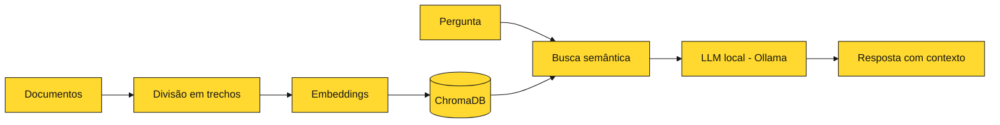

  

 

## ⚡ Sobre mim

Olá! Sou **Larissa Passos**, estudante de tecnologia com foco em **desenvolvimento de software** e **Inteligência Artificial**.

- 🎓 Técnica em **Análise e Desenvolvimento de Sistemas** pelo **SENAI CETEC**
- 📚 Cursando **Sistemas para Internet** no **IFTO**
- 🤖 Cursando **Inteligência Artificial e Machine Learning** na **UniCesumar**
- 🧠 Aprofundando conhecimentos em **IA Generativa, LLMs, RAG e integração de sistemas**
- 🛠️ Aplicando o que aprendo em **projetos práticos**
- 🖥️ Experiência anterior em **suporte técnico**, manutenção de computadores, configuração de sistemas, redes e atendimento a usuários
- 🎯 Buscando **estágio** e **posições júnior** em desenvolvimento de software, Python e IA

 

## ⚡ Tecnologias

**Linguagens**

**Back-end e banco de dados**

**Inteligência Artificial**

**Ferramentas**

 

## ⚡ Projeto em destaque

### 📄 DocIA / DevIA — Assistente Inteligente de Documentos

Aplicação em desenvolvimento para explorar **RAG**, recuperação de informações e **modelos de linguagem locais**.

| | |
|---|---|
| **Status** | 🚧 Em desenvolvimento |
| **Tecnologias** | Python · FastAPI · Ollama · ChromaDB · Embeddings · Pytest |
| **Objetivo** | Explorar busca semântica e recuperação contextual com LLMs rodando localmente |

- ⚡ Desenvolvimento de aplicação em Python com API em FastAPI
- ⚡ Integração com modelos de linguagem locais via Ollama
- ⚡ Implementação e testes (Pytest) de componentes de recuperação de informações
- ⚡ Estudos de busca semântica e recuperação contextual com embeddings e ChromaDB

Consulte o repositório para verificar as funcionalidades implementadas na versão atual.

 

## ⚡ O que estou estudando: como um RAG funciona

 

## ⚡ Formação acadêmica

| Curso | Instituição | Status |
|---|---|---|
| Inteligência Artificial e Machine Learning | UniCesumar | 📘 Em andamento |
| Sistemas para Internet | IFTO | 📘 Em andamento |
| Técnico em Análise e Desenvolvimento de Sistemas | SENAI CETEC | ✅ Concluído em 2023 |
| Ensino Médio | Escola Estadual Frederico José Pedreira Neto | ✅ Concluído em 2022 |

 

## ⚡ Experiência e conhecimentos

<b>💻 Desenvolvimento</b>

 

- Desenvolvimento full stack
- Python, automação e aplicações de Inteligência Artificial
- Integração de APIs e sistemas
- Desenvolvimento de projetos para aprofundar conhecimentos em IA

<b>🖥️ Suporte e infraestrutura</b>

 

- Suporte técnico
- Manutenção de computadores
- Configuração de sistemas
- Redes
- Atendimento a usuários

 

## ⚡ Áreas de interesse

`Python` · `IA Generativa` · `LLMs` · `RAG` · `Agentes de IA` · `APIs REST` · `Automação`

 

## ⚡ Meus objetivos

- 🎯 Conquistar uma vaga de **estágio** ou **júnior** em desenvolvimento de software, Python ou IA
- 🧠 Aprofundar em **IA Generativa**, **LLMs**, **RAG** e **agentes de IA**
- 🔌 Construir projetos que integrem **APIs, sistemas e modelos de linguagem**
- 🚀 Evoluir a cada projeto e compartilhar o aprendizado

 

## ⚡ Estatísticas do GitHub

 

 

 

## ⚡ Vamos nos conectar?

  

*Aprendendo, desenvolvendo e evoluindo a cada projeto. ⚡*

