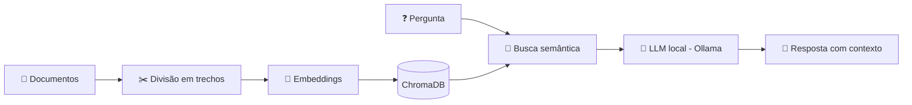

<div align="center">


<a href="https://github.com/Larissor/Larissor">
  
</a>

<br/>


<br/>


</div>

---

## ⚡ Sobre mim

```python
class LarissaPassos:
    def __init__(self):
        self.foco = ["Desenvolvimento de Software", "Inteligência Artificial"]
        self.formacao = [
            "Técnica em Análise e Desenvolvimento de Sistemas (SENAI CETEC)",
            "Sistemas para Internet (IFTO) - em andamento",
            "IA e Machine Learning (UniCesumar) - em andamento",
        ]
        self.estudando_agora = ["IA Generativa", "LLMs", "RAG", "Integração de sistemas"]
        self.objetivo = "Estágio ou posição júnior em Dev, Python e IA"

    def aprender(self):
        return "Aprendendo, desenvolvendo e evoluindo a cada projeto ⚡"
```

Olá! Sou **Larissa Passos**, estudante de tecnologia com foco em **desenvolvimento de software** e **Inteligência Artificial**.

- 🎓 Técnica em **Análise e Desenvolvimento de Sistemas** pelo **SENAI CETEC**
- 📚 Cursando **Sistemas para Internet** no **IFTO**
- 🤖 Cursando **Inteligência Artificial e Machine Learning** na **UniCesumar**
- 🧠 Aprofundando conhecimentos em **IA Generativa, LLMs, RAG e integração de sistemas**
- 🛠️ Aplicando o que aprendo em **projetos práticos**
- 🖥️ Experiência anterior em **suporte técnico**, manutenção de computadores, configuração de sistemas, redes e atendimento a usuários
- 🎯 Buscando **estágio** e **posições júnior** em desenvolvimento de software, Python e Inteligência Artificial

---

## ⚡ Tecnologias

### 💻 Linguagens

<p>
  
  
  
</p>

### 🔌 Back-end e banco de dados

<p>
  
  
  
  
</p>

### 🤖 Inteligência Artificial

<p>
  
  
  
  
  
  
</p>

### 🧰 Ferramentas

<p>
  
  
  
  
</p>

---

## ⚡ Projeto em destaque

<div align="center">

### 📄 DocIA / DevIA — Assistente Inteligente de Documentos

</div>

Aplicação em desenvolvimento para explorar **RAG**, recuperação de informações e **modelos de linguagem locais**.

| | |
|---|---|
| **Status** | 🚧 Em desenvolvimento |
| **Tecnologias** | Python · FastAPI · Ollama · ChromaDB · Embeddings · Pytest |
| **Objetivo** | Explorar busca semântica e recuperação contextual com LLMs rodando localmente |

**O que está envolvido no projeto**

- ⚡ Desenvolvimento de aplicação em Python com API em FastAPI
- ⚡ Integração com modelos de linguagem locais via Ollama
- ⚡ Implementação e testes (Pytest) de componentes de recuperação de informações
- ⚡ Estudos de busca semântica e recuperação contextual com embeddings e ChromaDB

<div align="center">
  <a href="https://github.com/Larissor/DocIA">
    
  </a>
</div>

<sub>Consulte o repositório para verificar as funcionalidades implementadas na versão atual.</sub>

---

## ⚡ Como um RAG funciona (o que estou estudando)



---

## ⚡ Formação acadêmica

| Curso | Instituição | Status |
|---|---|---|
| Inteligência Artificial e Machine Learning | UniCesumar | 📘 Em andamento |
| Sistemas para Internet | IFTO | 📘 Em andamento |
| Técnico em Análise e Desenvolvimento de Sistemas | SENAI CETEC | ✅ Concluído em 2023 |
| Ensino Médio | Escola Estadual Frederico José Pedreira Neto | ✅ Concluído em 2022 |

---

## ⚡ Experiência e conhecimentos

<details>
<summary><b>💻 Desenvolvimento</b></summary>
<br/>

- Desenvolvimento full stack
- Python, automação e aplicações de Inteligência Artificial
- Integração de APIs e sistemas
- Desenvolvimento de projetos para aprofundar conhecimentos em IA

</details>

<details>
<summary><b>🖥️ Suporte e infraestrutura</b></summary>
<br/>

- Suporte técnico
- Manutenção de computadores
- Configuração de sistemas
- Redes
- Atendimento a usuários

</details>

---

## ⚡ Áreas de interesse

<div align="center">

`Python` · `IA Generativa` · `LLMs` · `RAG` · `Agentes de IA` · `APIs REST` · `Automação`

</div>

---

## ⚡ Meus objetivos

- 🎯 Conquistar uma vaga de **estágio** ou **júnior** em desenvolvimento de software, Python ou IA
- 🧠 Aprofundar em **IA Generativa**, **LLMs**, **RAG** e **agentes de IA**
- 🔌 Construir projetos que integrem **APIs, sistemas e modelos de linguagem**
- 🚀 Evoluir a cada projeto e compartilhar o aprendizado

---

## ⚡ Estatísticas do GitHub

<div align="center">


<br/>


<br/>


</div>

---

## ⚡ Vamos nos conectar?

<div align="center">

<a href="https://github.com/Larissor">
  
</a>
<a href="https://www.linkedin.com/in/lariissapassos/">
  
</a>

<br/><br/>

*Aprendendo, desenvolvendo e evoluindo a cada projeto. ⚡*


</div>
